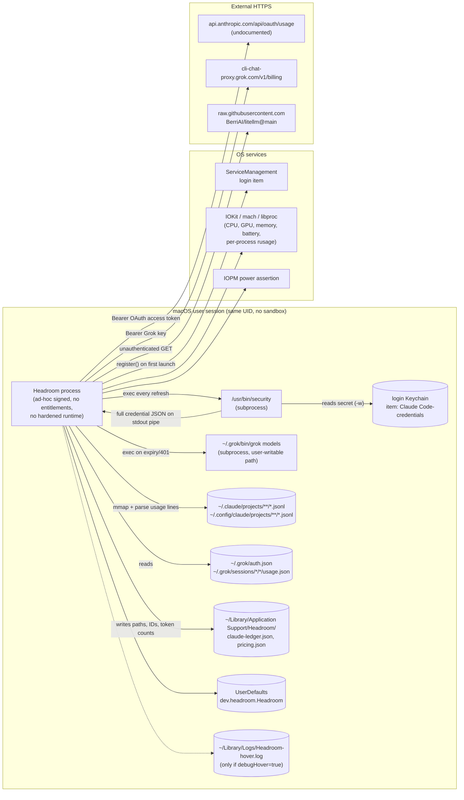

# Audit 0003 — Credential access, local permissions and external egress

Issue: [#3](https://github.com/loloDawit/spandeck/issues/3) · Parent: [#2 M0 tracker](https://github.com/loloDawit/spandeck/issues/2) · Related: [#4](https://github.com/loloDawit/spandeck/issues/4), [#5](https://github.com/loloDawit/spandeck/issues/5), [#7](https://github.com/loloDawit/spandeck/issues/7), [#10](https://github.com/loloDawit/spandeck/issues/10), [#11](https://github.com/loloDawit/spandeck/issues/11)

Audited revision: `c60d3d9` (`main`, inherited Headroom v1.1 source). Date: 2026-10-13.

## Evidence classes

Every finding is tagged:

- **[code]** — observed by reading source at the audited revision. Describes what the code is written to do, not what was seen at runtime.
- **[runtime]** — observed by executing something on a real machine; the procedure is stated.
- **[hypothesis]** — plausible but unverified; listed with the check that would confirm or refute it.

**Scope limit:** the application itself was **not launched** for this audit, because a launch on a developer machine reads the real Claude Code Keychain item, calls `api.anthropic.com`, registers a login item and scans real transcripts (see §6). All application behavior below is therefore **[code]** unless marked otherwise. The only [runtime] observations are the build/test run and the `HOME` isolation probe in §6.

**[runtime] Build/test baseline** (this audit, Apple Swift 6.3.3, macOS 26.5, arm64): `swift build` passed (debug); `swift test` passed — 22 Swift Testing tests in 5 suites; the `Clients.swift:177` warning reproduced (§4). No release, universal or signed build was produced.

## 1. Trust boundaries and data flow

| # | Boundary | Mechanism | Auth | Data sensitivity | Consent state today | Evidence |
|---|---|---|---|---|---|---|
| B1 | Process → login Keychain | `/usr/bin/security find-generic-password -s "Claude Code-credentials" -w` | macOS Keychain ACL for the calling binary (`/usr/bin/security`) | **Secret**: entire credential JSON blob; code reads `claudeAiOauth.accessToken`, `.expiresAt`, `.subscriptionType`, `.rateLimitTier` | None. Automatic on launch and every refresh | [code] `Clients.swift:65-73` |
| B2 | Process → Anthropic | `GET https://api.anthropic.com/api/oauth/usage` | `Authorization: Bearer <OAuth access token>`, `anthropic-beta: oauth-2025-04-20`, `User-Agent: claude-code/2.1 headroom` | Secret out; plan/quota percentages in | None | [code] `Clients.swift:86-91` |
| B3 | Process → Grok files | `Data(contentsOf: ~/.grok/auth.json)`; first non-empty `key` | File permissions only | **Secret** (Grok API key) | None. Automatic if file exists | [code] `Clients.swift:161-168` |
| B4 | Process → Grok CLI | `Process` exec of `~/.grok/bin/grok models`, 45 s timeout, stdout/stderr discarded | Inherits the app's environment and user privileges | Executes a user-writable, non-system binary | None. Triggered by file existence + expired/401 token | [code] `Clients.swift:170-178`, `Util.swift:86-101` |
| B5 | Process → Grok | `GET https://cli-chat-proxy.grok.com/v1/billing?format=credits` | `Authorization: Bearer <Grok key>`, `User-Agent: grok-cli headroom` | Secret out; credit percentages in | None | [code] `Clients.swift:202-207` |
| B6 | Process → LiteLLM pricing | `URLSession.shared.data(from:)` on `raw.githubusercontent.com/BerriAI/litellm/main/model_prices_and_context_window.json` | None (unauthenticated, unpinned branch, no integrity check) | Public data in; request reveals IP/UA/timing | None | [code] `Ledger.swift:104-130` |
| B7 | Process → Claude transcripts | Recursive enumeration of two roots; `Data(contentsOf:options:.alwaysMapped)`; lines containing `"usage":{` are JSON-parsed | File permissions only | **High**: transcripts contain prompts, source, tool I/O. Code only extracts `type`, `timestamp`, `requestId`, `message.{id,model,usage}` — but whole matched lines are parsed into memory | None | [code] `Ledger.swift:187-189, 235-245, 309-370` |
| B8 | Process → Grok sessions | `~/.grok/sessions/<project>/<session>/usage.json` read in full | File permissions only | Medium: token/cost per turn, model id, timestamps | None | [code] `Ledger.swift:391-426` |
| B9 | Process → local cache | Atomic writes to `~/Library/Application Support/Headroom/` | Default umask; no explicit permissions | **Medium**: `claude-ledger.json` stores full transcript **file paths** (which encode project directory names), `messageId:requestId` keys, per-hour/per-model token counts | None; no delete/retention UI (32-day prune only) | [code] `Ledger.swift:156-164, 184, 487-498`, `Util.swift:75-80` |
| B10 | Process → ServiceManagement | `SMAppService.mainApp.register()` | — | Persistence | **None on first launch**; toggle in settings afterwards | [code] `main.swift:39-42`, `PopoverView.swift:585-599` |
| B11 | Process → kernel/IOKit | `host_processor_info`, `host_statistics64`, `sysctlbyname`, `IOServiceGetMatchingService(s)` (IOAccelerator, AppleSmartBattery), `proc_listallpids`, `proc_pid_rusage`, `proc_pidpath`, `proc_name` | Unprivileged; other users'/root PIDs fail silently | Low–medium: names, paths, CPU/GPU/energy/footprint of all readable processes (per-process data only while a hover panel is shown) | Implicit (core feature) | [code] `SystemSampler.swift:58-185`, `Consumers.swift:41-155` |
| B12 | Process → power management | `IOPMAssertionCreateWithName` (idle system or display sleep) | Unprivileged | — | Manual action, or `awake.agents` pref (default **false**) | [code] `KeepAwake.swift:42-62`, `Store.swift:23-27` |
| B13 | Process → logs | `NSLog` on login-item failure (error only); hover debug log only when `debugHover` default is set (mouse coordinates/state) | — | Low | Debug opt-in | [code] `PopoverView.swift:597`, `Hover.swift:39-49` |
| B14 | Process → arbitrary dir | `--snapshot <dir>` writes PNGs of the status strip and popover, then exits | — | **Medium**: renders real limits/usage/cost into images | CLI argument | [code] `main.swift:44-46, 210-244` |

Not present [code]: no entitlements file, no App Sandbox, no hardened runtime, no local server/listener, no global event monitors (only `addLocalMonitorForEvents`, which needs no Input Monitoring permission — `Hover.swift:30`), no clipboard, AppleScript, `launchctl`, or hooks/status-line/settings mutation, no SPM dependencies (`Package.swift`).

## 2. Egress matrix

| Destination | Purpose | Content sent | Frequency | Timeout | Offline / failure behavior | User control | Evidence |
|---|---|---|---|---|---|---|---|
| `api.anthropic.com/api/oauth/usage` | Plan quota %, reset times | OAuth bearer token, beta header, UA impersonating `claude-code/2.1` | At launch; every 60 s timer (tolerance 2 s); on wake; on manual refresh. Suppressed for 300 s only after HTTP 429 | 15 s request (ephemeral `URLSession`, no disk cache/cookies) | Error string shown in UI; 401 → "Token expired, will retry" and **retried every 60 s with no backoff**; locally-expired token short-circuits before egress | **None.** `show.claude` toggle only hides the gauge — it does not stop the Keychain read or the request | [code] `main.swift:50-53, 67-70, 105-122`, `Clients.swift:43-48, 82-91`, `StatusRenderer.swift:35` |
| `cli-chat-proxy.grok.com/v1/billing` | Grok credit usage | Grok bearer key | Same cadence as above (not subject to the 429 backoff); only when `~/.grok/auth.json` has a key | 15 s | 402/403/404 (and 401 after refresh) → `.notConfigured` → provider silently hidden as "Not set up" | **None.** `show.grok` only hides display | [code] `main.swift:123-135`, `Clients.swift:180-207`, `StatusRenderer.swift:40` |
| `raw.githubusercontent.com/BerriAI/litellm/main/...json` | Model price table for cost estimates | Plain GET (IP, default `URLSession` UA) | At launch if `pricing.json` is missing, empty, or older than 24 h. **Not refreshed while running** | `URLSession.shared` default (60 s request timeout); default shared URL cache and cookie storage | Silent; cached table (if any) remains. With no table, cost is `nil` per model but **summed as $0** into today/week/month totals (missing becomes zero — see #7) | None | [code] `main.swift:26`, `Ledger.swift:106-130, 459-465` |

No other `URL(string:)`, `URLSession`, socket, URL-opening or subprocess call sites exist in `Sources/` [code] (grep for `URL(`, `URLSession`, `socket`, `NWConnection`, `openURL`, `Link(`, `NSWorkspace.shared.open`, `WKWebView`, `Process(`, `runProcess`).

## 3. Permissions inventory and least-privilege recommendations

| Capability | Current | Needed for core value? | Least-privilege recommendation | Documented alternative |
|---|---|---|---|---|
| Read Claude Code OAuth credential from Keychain | Every refresh (≥ once/min), via `/usr/bin/security -w`, whole JSON blob piped into process memory | No — quota gauge only | Default off; explicit opt-in with capability label "unofficial"; never read while disabled; read only the needed fields; consider not retaining between refreshes | Candidate documented surfaces (to verify in #10): Claude Code status-line input, Claude Code OpenTelemetry metrics, `/usage` in-CLI. Admin/Usage APIs target org API keys, not subscriptions |
| Call `api.anthropic.com/api/oauth/usage` | Undocumented endpoint, beta header, impersonating `User-Agent` | No | Opt-in only; honest UA; backoff on 401 as well as 429; label results "unofficial, may break" | Same as above |
| Read `~/.grok/auth.json` | Every refresh if present | No | Opt-in per provider | — |
| Execute `~/.grok/bin/grok` | Automatically on expiry/401, ≤ once per 10 min, exit status discarded | No | Remove automatic execution; if retained, opt-in, fixed minimal environment, surface failure | Ask user to run the CLI themselves |
| Download LiteLLM pricing | Launch-time, unpinned `main`, no integrity check | Partially (cost estimates) | Ship a bundled, reviewed snapshot; make updates opt-in; pin to a commit SHA + checksum; ephemeral session with explicit timeout; label prices with source/date | — |
| Read Claude transcripts | All `*.jsonl` under two roots, ≤ 32 days, every 10 s (hot tail) / 300 s (full scan) | **Yes** (core) | Keep read-only; parse only allowlisted fields; prove via canary fixtures (#5) | Status-line / OTel may reduce need (#10) |
| Write cache | Paths + message/request IDs + counts, default umask | Yes (performance) | Store no raw paths (hash or project-level opaque IDs); `0600` files / `0700` dir; user-visible delete; documented retention | — |
| Login item | **Registered on first launch without asking** | No | Default off; only via existing settings toggle; never silently unregister existing users | — |
| Process/IOKit sampling | Unprivileged, own-UID processes | Yes (inherited hardware feature) | Keep; per-process sampling already limited to hover visibility | — |
| Power assertion | Manual or opt-in agent mode (default off) | Optional | Keep as is | — |
| `--snapshot <dir>` | Writes real data to any path | No (dev tool) | Restrict to debug builds or synthetic store | — |

## 4. Observations on issue-comment question (`Clients.swift:177` warning)

- **[runtime]** Reproduced locally (Apple Swift 6.3.3, macOS 26.5, arm64): `Clients.swift:177:11: warning: expression of type '(status: Int32, output: Data)?' is unused`. Column 11 is `.value`: the detached task's closure returns the tuple, so `@discardableResult` on `runProcess` does not apply to `Task.value`.
- **[code]** Failure handling of the refresh subprocess:
  - Exit status, launch failure (`nil`) and timeout kill are all discarded (`Clients.swift:175-177`).
  - `lastRefresh` is set *before* attempting, so any failure suppresses retries for 600 s (`Clients.swift:171-172`).
  - After a failed refresh, a second 401 collapses into `ClientError.notConfigured` (`Clients.swift:191-196`), which the UI renders as "Not set up" and **hides the provider** (`main.swift:128-130`). A user cannot distinguish "refresh failed / token invalid" from "Grok not installed".
  - Secrets do not reach error strings: `ClientError.errorDescription` uses only static text and status codes (`Clients.swift:31-40`); subprocess stdout/stderr go to `/dev/null`.
- **Conclusion:** not a demonstrated runtime defect, but an observability gap (failure masked as absence). Tracked as R5 below.

## 5. Other findings

- **F1 [code] Display toggles do not gate collection.** `show.claude` / `show.grok` are consulted only in `StatusRenderer.swift:35,40`; `refreshLimits` (`main.swift:105-136`) has no preference check. Turning the gauge "off" still reads the Keychain and calls both APIs every minute.
- **F2 [code] Login-item registration is unconditional and unrecoverable on failure.** `didRegisterLoginItem` is set *before* `register()` and the result is swallowed by `try?` (`main.swift:39-42`); a failure is never retried or surfaced.
- **F3 [code] Directory creation as a launch side effect.** `appSupportDir` lazily creates `~/Library/Application Support/Headroom` on first access, which happens at launch via `Pricing.shared.load()` (`Util.swift:75-80`, `main.swift:26`).
- **F4 [code] Missing price becomes $0 in totals.** `summarize` uses `cost ?? 0` for aggregate totals while per-model rows keep `nil` (`Ledger.swift:459-476`). Accounting issue; belongs to #7.
- **F5 [code] Transcript paths persisted.** `State.files` keys are absolute transcript paths (`Ledger.swift:161, 255`), encoding the user's project directory names in `claude-ledger.json`. Belongs to #5.
- **F6 [code] Supply chain / distribution.** `build.sh:22` ad-hoc signs (`codesign --sign -`), no hardened runtime, no notarization; `build.sh install` kills, replaces and launches `/Applications/Headroom.app`. Workflows use tag-pinned (not SHA-pinned) `actions/checkout@v5`; `release.yml` has `contents: write`; `test.yml` declares no `permissions` block (inherits repo default). Belongs to #11.
- **F7 [hypothesis] Keychain prompt behavior.** Whether the read is silent depends on the item's ACL. If Claude Code writes the item via `/usr/bin/security`, that binary is likely already trusted and the read is silent; if the user ever clicks "Always Allow" for `/usr/bin/security`, *any* local process using the `security` CLI can read the item without prompting. **Check:** on a fresh test account, create a synthetic item with the same service name via `security add-generic-password`, run the app, and record whether a prompt appears; inspect the ACL with `security dump-keychain -a` (synthetic item only).
- **F8 [hypothesis] Cache file modes.** Files are written with the process umask (commonly `0644`) under `~/Library` (commonly `0700`). **Check:** `stat -f '%Sp %N'` on the cache files after a synthetic run.

## 6. Default launch: quiet/offline or side effects?

**Verdict [code]: the default launch is neither quiet nor offline.** `applicationDidFinishLaunching` (`main.swift:24-71`), with default preferences, performs in order:

1. Registers `UserDefaults` defaults; `Pricing.shared.load()` creates `~/Library/Application Support/Headroom/` and, with no cached table, starts an HTTPS GET to `raw.githubusercontent.com` (`main.swift:25-26`).
2. On first launch, `SMAppService.mainApp.register()` — adds a login item (`main.swift:39-42`). macOS typically shows a "Background item added" notification [hypothesis — confirm in §7].
3. Starts 1 Hz hardware sampling via mach/IOKit (`main.swift:48-49, 80-96`).
4. `refreshLimits()`: spawns `/usr/bin/security` to read the Claude credential; if present and unexpired, HTTPS to `api.anthropic.com`; if `~/.grok/auth.json` has a key, HTTPS to `cli-chat-proxy.grok.com`, possibly exec of `~/.grok/bin/grok` (`main.swift:50, 105-136`).
5. `refreshUsage()`: enumerates and memory-maps Claude transcripts and Grok usage files; writes `claude-ledger.json` (`main.swift:51, 138-155`).
6. Repeats (4) every 60 s and (5) every 10 s; both again on wake (`main.swift:52-56, 67-70`).

**[runtime] Isolation probe:** with `HOME` set to a scratch directory, a Swift script printed `FileManager.default.homeDirectoryForCurrentUser`, `NSHomeDirectory()` and the user Application Support URL — **all three still resolved to the real home directory**. Overriding `HOME` therefore does **not** isolate transcript reads, cache writes or Grok files, and `security` reads the UID's login Keychain regardless. A temp-`HOME` run is not a safe verification method.

## 7. Safe runtime verification procedure

Owner decision (2026-10-13): **no fabricated credentials are sent to real provider endpoints**, and the separate-account launch is deferred until the code has injectable dependencies. Verification therefore happens in two phases. Never paste tokens, real project paths or transcript content into issues.

### Phase 1 — mocked environment (prerequisite; tracked as R12 in #12)

Introduce seams so the default launch path can run under test with no real Keychain, network, subprocess, login-item or home-directory access:

| Seam | Production implementation | Test double records / asserts |
|---|---|---|
| `CredentialStore` | `/usr/bin/security` read (`Clients.swift:65-73`) | Calls count; returns a synthetic credential or `nil` |
| `HTTPTransport` (or a `URLProtocol` registered on injected `URLSession`s, including the pricing session) | `URLSession` (`Clients.swift:43-58`, `Ledger.swift:116`) | Every request's host, path and header *names*; returns canned 200/401/429/offline; fails the test on any unexpected host |
| `ProcessRunner` | `runProcess` (`Util.swift:86-101`) | Executable path + arguments; never executes |
| `LoginItemService` | `SMAppService.mainApp` (`main.swift:39-42`, `PopoverView.swift:585-599`) | `register`/`unregister` calls |
| Filesystem roots | `homeDir`, `appSupportDir` (`Util.swift:75-82`) | Temp directories with synthetic transcripts containing a canary string (`HOME` override does **not** work, see §6) |

Phase 1 acceptance tests (all synthetic, run in `swift test`):

1. Default launch records exactly the calls listed in §6 — this is the reproducible confirmation of the "not quiet / not offline" verdict.
2. Disabling the Claude/Grok display toggles does not stop credential reads or requests (documents F1 today; flips to "no calls" once R3 lands).
3. Grok 401 → refresh → 401 yields `.notConfigured` and one `ProcessRunner` call (documents §4 today; flips with R5).
4. After a refresh cycle, the temp cache directory contains the synthetic transcript path (F5) and never the canary string.
5. Pricing request is issued at launch when no cache exists; with the transport offline, unpriced models contribute $0 to totals (F4).

### Phase 2 — dedicated-account observation (optional, after Phase 1)

Only to confirm OS-level effects the mocks cannot (login-item notification, real file modes, real process tree):

1. New macOS user account or VM with **no Claude Code or Grok credentials at all** — do not create synthetic Keychain items or Grok keys, so no credential leaves the machine.
2. Launch `build/Headroom.app` (built with `./build.sh`, not `install`).
3. Observe only: `lsof -nP -i -a -p $(pgrep -x Headroom)` / `nettop` (expect only `raw.githubusercontent.com`), `security` once per minute in the process list, Login Items before/after first launch, `stat -f '%Sp %N'` on `~/Library/Application Support/Headroom/`.
4. Teardown: unregister the login item via the settings toggle, quit, delete the account.
5. Report only hostnames, counts, file names/modes and pass/fail.

## 8. Remediation mapping

Owner decision (2026-10-13): fold remediation into existing M0 issues; create a new issue only for distinct, independently actionable work. Implementation goes in separate, small PRs.

| ID | Priority | Remediation | Risk addressed | Compatibility impact | Rollback | Concrete tests | Tracked in |
|---|---|---|---|---|---|---|---|
| R1 | P0 | Stop registering login item on first launch | Surprising persistence (B10, F2) | New installs no longer auto-start; existing registrations untouched (do not silently unregister) | Revert commit | `LoginItemService` fake: launch path never calls `register()`; toggle calls register/unregister and reflects status | #4 |
| R2 | P0 | Gate Claude Keychain read + usage endpoint behind explicit opt-in (default off) | Credential exposure (B1, B2, F1) | Existing users lose quota gauge until they opt in; ledger unaffected | Revert; or default the pref to on | `CredentialStore` fake: zero calls when disabled; transport records no request | #4 |
| R3 | P1 | Make provider display toggles gate collection (Claude, Grok) | Collection continues when user "turns off" (F1) | None visible | Revert | Phase 1 test 2 flips to "no calls" | #4 |
| R4 | P1 | Remove automatic execution of `~/.grok/bin/grok`; Grok opt-in | Unexpected exec of user-writable binary (B4) | Grok tokens no longer auto-refreshed; user runs CLI | Revert | `ProcessRunner` fake asserts no exec; Grok disabled by default | #4 |
| R5 | P1 | Surface Grok refresh/auth failures distinctly from "not configured" | Failure masked as absence (§4) | UI shows an error state instead of hiding Grok | Revert | Phase 1 test 3 yields an auth-error state; error text contains no key material | #4 |
| R6 | P1 | Pricing: bundled reviewed snapshot, pinned (commit SHA + checksum) opt-in updates, explicit timeout, ephemeral session | Unpinned remote data, silent egress (B6) | Prices may lag until updated | Revert to remote fetch | Default launch issues no pricing request; checksum mismatch rejected; table provenance (source/date) exposed | #7 (provenance), #11 (integrity/pinning) |
| R7 | P1 | Unknown price is not $0 in totals | Under-reported cost (F4) | Totals may show "partial" instead of a number | Revert | Fixture with unpriced model → total flagged partial/unknown | #7 |
| R8 | P1 | Minimize ledger cache: no raw paths, `0600`/`0700` modes, user-visible delete | Local disclosure (B9, F5, F8) | Cache schema bump (`version` 3→4) forces one re-index | Old version file ignored by version check; revert restores old format | Phase 1 test 4: no transcript paths or canary in cache; mode assertions | #5 |
| R9 | P2 | Honest `User-Agent` for any retained provider call; back off on 401 | Client impersonation; repeated invalid-token requests | None visible | Revert | Transport fake asserts UA value and 401 backoff | #4 |
| R10 | P2 | Restrict `--snapshot` to debug builds or a synthetic store | Real data rendered to arbitrary path (B14) | Release builds lose snapshot flag | Revert | Argument ignored in release configuration | #5 |
| R11 | P2 | CI/release hardening: SHA-pin actions, explicit least `permissions` in `test.yml`, Developer ID signing + notarization plan | Supply chain (F6) | None for users until release | Revert workflow change | Workflow lint (e.g. `actionlint`, pin check) | #11 |
| R12 | P1 | Injectable dependencies + mocked default-launch tests (§7 Phase 1) | No reproducible runtime evidence; prerequisite for R1–R9 tests | Internal refactor only; no behavior change | Revert | Phase 1 tests 1–5 pass and document current behavior | #12 (new: distinct prerequisite; informs #9) |

## 9. Acceptance checklist for #3

- [x] Trust-boundary / data-flow diagram with paths, APIs, auth, sensitivity, consent state — §1
- [x] Egress matrix — §2
- [x] Permissions inventory and least-privilege recommendations, documented vs unofficial — §3 (documented-surface claims to be verified in #10)
- [x] Safe runtime verification procedure — §7 (mocked first; no fabricated credentials to real endpoints)
- [x] Prioritized remediation with risk, compatibility, rollback and tests — §8, mapped to #4, #5, #7, #11 and new issue #12 for R12
- [ ] Default launch confirmed with reproducible runtime observations — §6 gives the [code] verdict; **runtime confirmation pending** §7 Phase 1 (R12)
